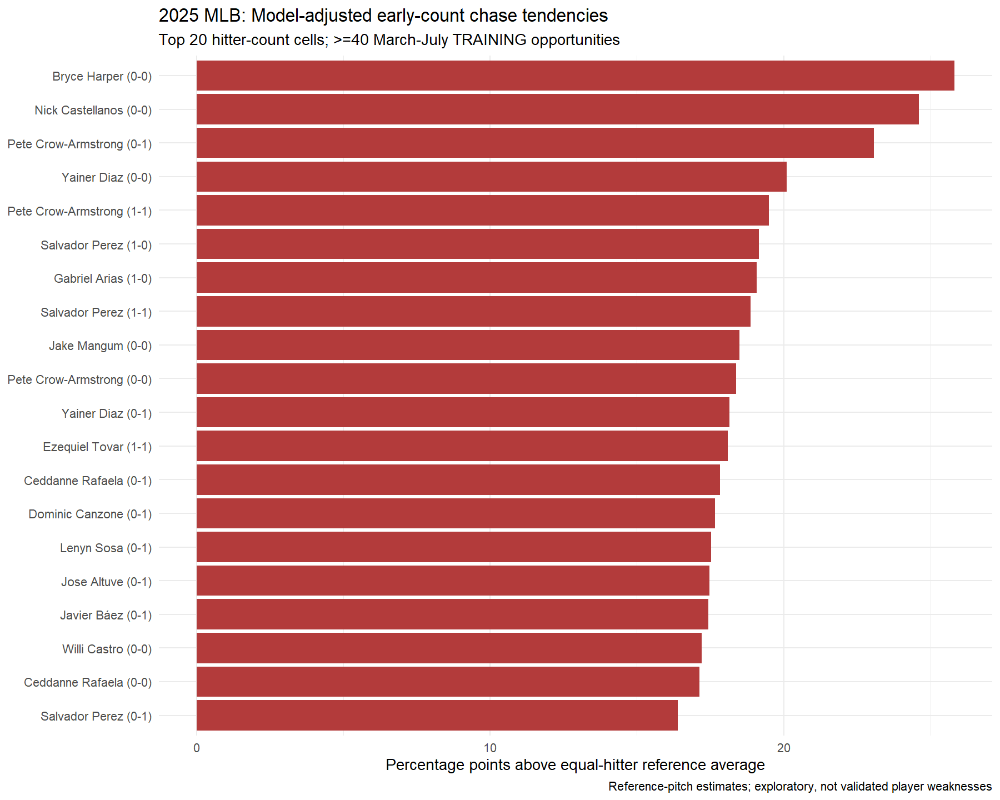
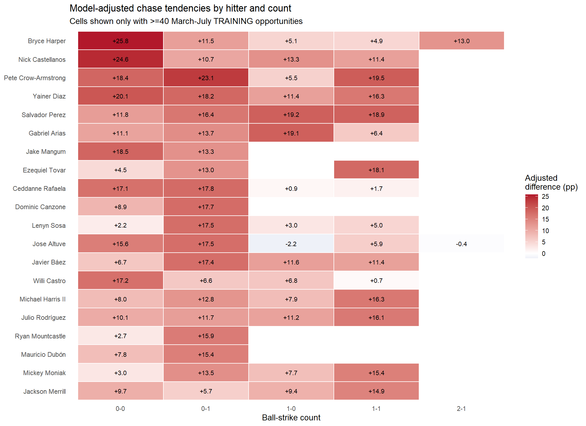
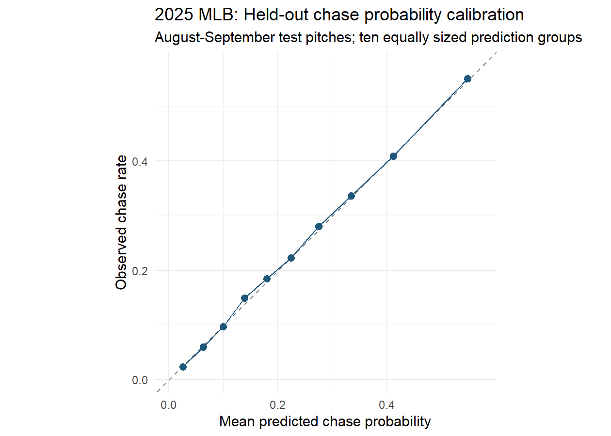

# 2025 MLB Early-Count Chase Analysis

**R | Statcast | Logistic regression | Ridge regularization | Out-of-time evaluation**

**[Read the full report](https://kallal044a.github.io/mlb-early-count-chase-analysis/)** (also in this repository as [`docs/index.html`](docs/index.html))

## Research question

Which MLB hitters swing at pitches outside the strike zone before reaching two strikes, in which counts, and do hitter-specific tendencies improve predictions of future swings?

A full write-up with figures, uncertainty intervals and limitations is in [`chase_report.qmd`](chase_report.qmd).

## Key findings

- Analyzed **712,528 regular-season Statcast pitch records** from 2025. The final modeling sample contained **229,974 off-zone pitches** with fewer than two strikes.
- Models were built on March through July and tested once on **75,685 August-September pitches** they had not seen.
- A **pitch-adjusted model** (count, distance outside the zone, pitch type, speed, handedness) cut held-out log-loss from **0.541 to 0.475** compared with a constant league rate.
- Adding **hitter-by-count terms** improved it further, to **0.467** (Brier score 0.153 versus 0.156). The hitter information helps, but most of the predictive power comes from the pitch and the situation.
- The ranking carries forward. Among **1,292 hitter-count cells** (412 hitters) with at least 40 March-July pitches, the top-ranked tenth chased **33.3%** of the time in August-September versus 32.5% predicted. The bottom-ranked tenth chased 16.0% versus 16.5% predicted. Beyond what the pitch-only model expects, the top tenth swung about **19 percentage points more** than the bottom tenth (95% interval 16.6 to 21.0).
- Raw hitter chase rates predict much worse than the model (log-loss 0.525 for a hitter's overall rate, 0.515 for his rate in that count, 0.470 for context only, 0.460 for the hitter-count model). Thirteen of the model's top 20 hitters also appear in the top 20 by raw overall chase rate, so the value of the model is mainly the count-specific, pitch-adjusted estimates and not new names.

## Model performance

| Model | Held-out log-loss (lower better) | Held-out Brier score (lower better) |
|---|---:|---:|
| Training league rate | 0.541 | 0.178 |
| Pitch-adjusted ridge | 0.475 | 0.156 |
| Pitch + hitter-count ridge | **0.467** | **0.153** |

Models were developed on March-June pitches, tuned on July, refit through July, and evaluated on August-September pitches. This is a retrospective temporal evaluation, not a prospective test.

## Figures

### Model-adjusted hitter/count leads

These are **conditional model estimates for a shared reference pitch** (changeup, right-handed hitter and pitcher, median speed and distance), compared with an equally weighted average across training hitters. They are not season-wide chase rates or proof of exploitability. Both this chart and the heat map require at least 40 off-zone pitches in the March-July training period.

### Hitter-by-count heat map

### Held-out calibration

## Methods in plain English

A **chase** is a swing at a pitch Statcast classified outside the strike zone (`zone` 11-14) before the hitter had two strikes. Automatic events, pitchouts, unknown pitch types and rows missing tracking data were excluded. Hit-by-pitch counts as not a swing.

The models are **ridge-penalized logistic regressions** fit with `glmnet`. The pitch-adjusted model uses count, approximate distance outside the zone, pitch-type group, speed and handedness. The second model adds a regularized term for each hitter in each count, which shrinks small samples toward the average. The penalty is chosen on July pitches, the grid runs from 1e-1 to 1e-7, glmnet's internal standardization is off (so sparse hitter-count cells are penalized like the others), and numeric covariates are z-scored using development-period statistics.

Rankings, eligibility and the observed rates in the output files use **only March-July pitches**. The `TestOpportunities` and `TestRate` columns are for validation only.

## Limitations

- Predictive and descriptive, not causal. Pitcher identity, sequencing and park are not adjusted.
- Every hitter is scored on one reference pitch, so the output cannot say which pitch types or locations a hitter chases. It also does not say what happens after the swing.
- The comparison is with other hitters in the same count. It does not say in which counts a given hitter chases more than in his other counts.
- One season; modeling choices were made while knowing the full season, so the August-September result is a retrospective check.
- The top of the list is selected from over a thousand cells, so individual estimates are uncertain even though groups of cells were well calibrated. There are no per-hitter interval estimates.
- Counts such as 2-0, 3-0 and 3-1 have too few qualifying pitches to appear in the rankings.

## Files

- [`chase_report.qmd`](chase_report.qmd): Quarto report with the full narrative, figures and limitations
- [`scripts/analysis.R`](scripts/analysis.R): Full analysis code
- [`results/holdout_model_performance.csv`](results/holdout_model_performance.csv): Test-set model comparison
- [`results/scouting_shortlist_training_min40.csv`](results/scouting_shortlist_training_min40.csv): Hitter/count estimates requiring at least 40 March-July pitches
- [`results/league_chase_by_count.csv`](results/league_chase_by_count.csv): League count-level rates
- [`results/session_info.txt`](results/session_info.txt): R and package versions used
- [`figures/`](figures/): Visualizations
- [`methodology_and_limitations.txt`](methodology_and_limitations.txt): Additional technical notes
- [`VALIDATION_NOTES.md`](VALIDATION_NOTES.md): Log of the review and fixes

## Reproducing the analysis

The code requires R and the packages `dplyr`, `tidyr`, `ggplot2`, `readr`, `Matrix`, `glmnet` and `tibble` (with optional `baseballr` for player names). It expects a `statcast_2025` object with 2025 regular-season Statcast data; a commented block in the script loads daily CSVs from a local `statcast_2025_daily/` folder. Set the working directory to the project folder, or set `CHASE_OUT_DIR`, to choose where outputs are written. **Raw Statcast data is not included**, so running the script requires obtaining those files first.

To render the report, place the daily Statcast CSV files (one per game date, e.g. `2025-03-18.csv`) in a `statcast_2025_daily/` folder in the project root, then render `chase_report.qmd` with Quarto. To keep the data elsewhere, set the environment variable `STATCAST_DAILY_DIR` to that folder (and `CHASE_PROJECT_DIR` if you render from outside the project folder). Rendering takes a few minutes.

Data source: MLB Statcast, accessed using the R `baseballr` package. This is an independent research/portfolio project, not an official MLB or St. Louis Cardinals publication.
